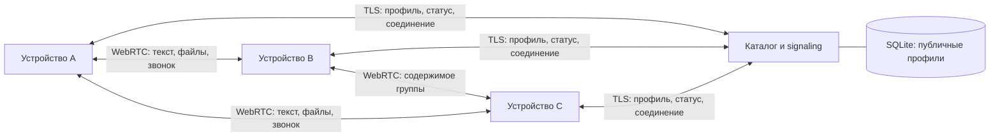

# LastCall 0.2: общий каталог и прямые разговоры

Дата: 2026-10-27. [Контракт компонентов](V2-CONTRACT.md).
Боты, каналы и бэкапы исключены. Android/iOS используют React Native/Expo Router,
native WebRTC и общий TypeScript core; браузерный probe проверяет транспорт.

## Общая координация

Устройство держит один авторизованный WebSocket `/directory`. Сервер объединяет
всех пользователей: поиск @username, подписка на статусы контактов, уведомления
о необходимости соединиться. SQLite сохраняет только публичный профиль, ключ,
идентификатор и lastSeen. Online определяется текущим сокетом. Новый сокет заменяет
предыдущий с той же идентичностью без ошибочного offline при старом disconnect.

Приложение не ограничено двумя пользователями. Двухместная комната `/signal` —
внутренний транспорт одной пары; MessengerClient управляет независимыми сеансами.
Переход между экранами сохраняет каталог и сеансы. При потере сети служебное
соединение восстанавливается с ограниченной задержкой. ОС может приостанавливать
процесс в фоне: APNs/FCM и системные входящие звонки ещё не реализованы.

## Идентичность и шифрование

Ed25519 seed создаётся на устройстве и сохраняется в SecureStore. User ID — SHA256
публичного ключа. Подпись включает одноразовый 15-секундный challenge, публичный
ключ, username и отображаемое имя. Сервер проверяет подпись и уникальность username.

Пара выводит общий секрет из преобразованных ключей Ed25519→X25519 и HKDF с
разделением назначения. Сервер не получает этот секрет. Из него получаются
непрозрачная комната и ключи XChaCha20-Poly1305 для SDP/ICE signaling. DTLS fingerprint
связан с аутентифицированным signaling. WebRTC DTLS защищает DataChannel, SRTP —
аудио/видео. Используются noble-curves/ciphers/hashes, собственных примитивов нет.
Контакт привязан к user ID/ключу; username — изменяемое имя в каталоге.

Это экспериментальный протокол: нет независимого аудита, ratchet, key transparency,
отзыва/миграции устройства или безопасного мультиустройства. Перед применением для
чувствительной переписки требуется отдельный дизайн и проверка безопасности.

## Чаты, группы и хранение

Текст подтверждается получателем по DataChannel; отправка в сокет сама по себе не
означает доставку. Недоставленный текст находится в локальной зашифрованной очереди
и повторяется после соединения. Сервер не является офлайн-почтой: отправитель тоже
должен вернуться в сеть. Состояние контактов/групп/недавней истории шифруется ключом
из seed с отдельным HKDF-контекстом; запись сериализуется. Бэкапы Android отключены.

Группы до 8 участников используют прямую рассылку каждому участнику. Создатель
передаёт неизменяемое определение состава по аутентифицированным P2P-каналам;
сервер не принимает определения групп. Текст считается доставленным после ACK
всех адресатов. Групповых звонков пока нет. Файл до 5 МиБ требует соединения со
всеми адресатами; без очереди, сохранения payload после перезапуска и возобновления.

Ограничения клиента: 100 контактов, 32 группы, 500 текстов суммарно/100 на чат,
100 ожидающих текстов, 16 активных пар. Неиспользуемые пары освобождаются при
достижении лимита. Это пределы preview, а не итоговая ёмкость продукта.

## Сеть и метаданные

Основной endpoint — https://lienad.ru/messenger. URL helper сохраняет namespace
для /directory, /signal и /ice; Caddy снимает префикс. Старый p2p.lienad.ru работает
при наличии записи у DNS-резолвера. Основной gateway проверяется без IP-подмены.

Сервер видит публичные профили, статусы, IP, время, непрозрачные комнаты и размеры
signaling. Прямое соединение раскрывает IP собеседнику. Публичный preview явно
использует STUN Google/Cloudflare; провайдеры видят discovery IP. TURN не настроен:
строгий NAT и блокировка UDP могут помешать соединению. Шифрование не скрывает
сам факт использования WebRTC от DPI. Маскировка и резервные транспорты — отдельный
этап после измерений российских сетей.

WebRTC/Opus и ограничение аудиобитрейта по измеренным RTT/потерям — основа адаптации.
Синтетические проверки медиа не доказывают разборчивость речи на плохой связи.
Полевые измерения качества, потребления батареи и доступности ещё нужны.
